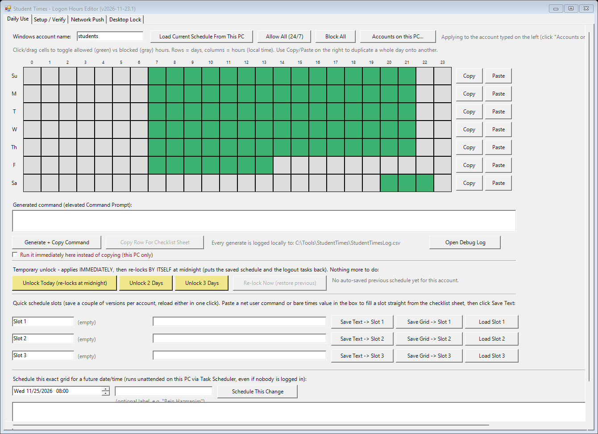
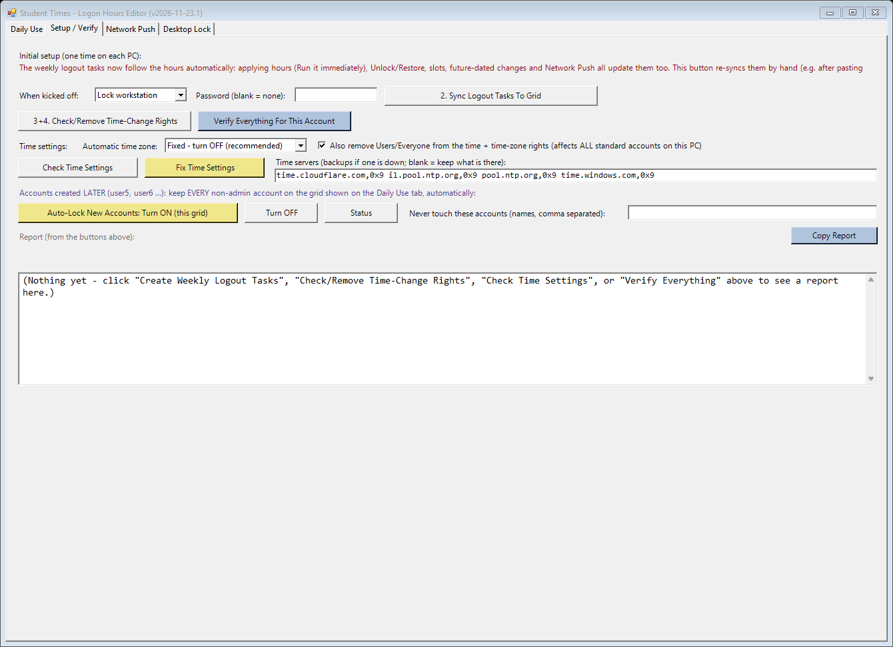
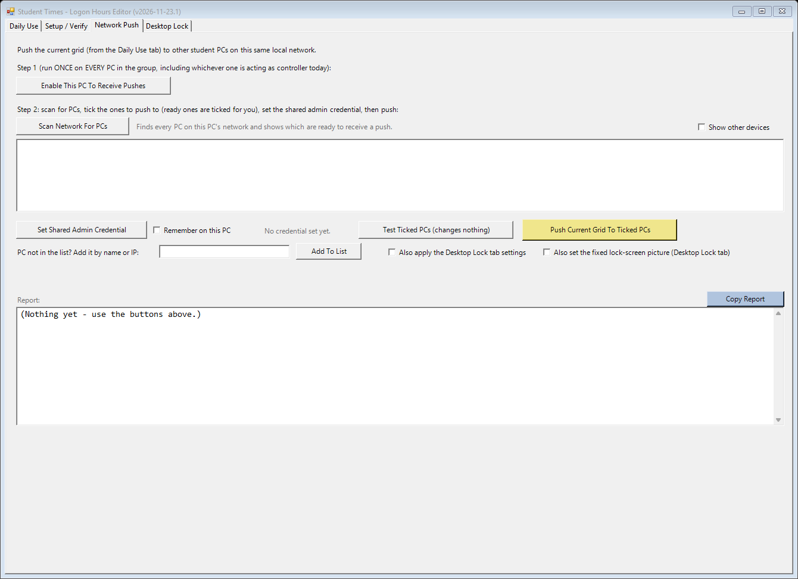
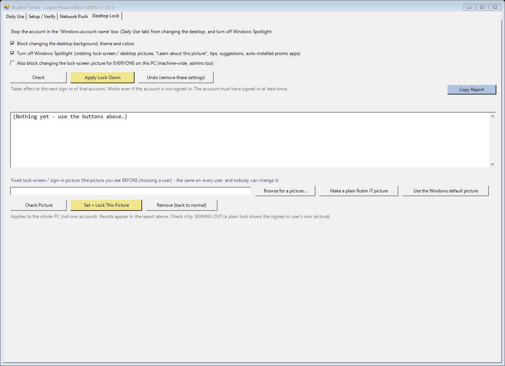

# Student Times

**Set the hours a Windows account is allowed to sign in, with a point-and-click grid.**

Schools and homes often need student or kids' computers to be usable only at certain times. Windows can
already do this (`net user <name> /times:...`), but typing those commands by hand is slow and easy to get
wrong. Student Times puts a simple weekly grid on top of it: click the hours that are allowed, press one
button, done. It also handles the extras that make the restriction actually stick: logging the student
out when time is up, stopping them from changing the clock, and pushing the same schedule to every PC in
a classroom.

## Quick start

1. Copy this whole folder onto the student PC (or run it from a USB stick or a shared drive).
   Keep the files together.
2. Double-click **`Run-StudentTimes.bat`** and say **Yes** to the administrator prompt.
3. Type the Windows account name (for example `students`), or click **Accounts on this PC...** and tick
   the accounts you want.
4. Click or drag across the grid: **green = allowed, grey = blocked**.
5. Tick **Run it immediately here** and click **Generate**. That's it: the account can now sign in only
   during the green hours.

No installation and no PowerShell settings to change first. Works on Windows 10 and 11 with the built-in
Windows PowerShell 5.1.

## What's in the window

### Daily Use

- **The weekly grid.** 7 days x 24 hours. Click or drag to toggle. **Copy / Paste** buttons copy a whole
  day onto another.
- **Load Current Schedule From This PC** reads what the account is set to right now.
- **Generate + Copy Command** makes the exact `net user` command and copies it, if you prefer to paste it
  into an administrator Command Prompt yourself. Tick **Run it immediately here** to have the tool apply it
  for you (it asks first).
- **Several accounts at once.** **Accounts on this PC...** lists the local accounts with tick boxes
  (common student account names are pre-ticked, administrators never are). Every action then applies to
  all ticked accounts.
- **Temporary unlock.** **Unlock Today / 2 Days / 3 Days** opens the account right away and **locks it
  again by itself** at midnight of the last day, putting the saved schedule back. **Re-lock Now** ends
  the unlock early.
- **Quick slots.** Save up to three named schedules (e.g. "Term", "Holidays") and load one in a click.
- **Schedule a change for later.** Pick a date and time and the grid is applied then by Task Scheduler,
  even if nobody is signed in.

### Setup / Verify (once per PC)

- **Logout tasks.** Windows' logon hours stop a *new* sign-in, but they don't throw out someone who is
  already signed in. Student Times creates scheduled tasks that lock or sign out the account at the end
  of each allowed block. They are kept in step with the grid automatically.
- **Time-change rights.** Removes the right to change the clock or time zone, so a student can't just
  move the clock back.
- **Check / Fix Time Settings.** Makes sure the PC's clock really syncs (with a list of backup time
  servers), keeps daylight-saving on and the time zone fixed.
- **Auto-lock new accounts.** Optional. Any new non-admin account created later gets the same hours
  automatically.
- **Verify Everything** prints a plain report of what is set and what is missing.

### Network Push (a whole classroom at once)

1. On every PC in the group, run **`Enable-PushAcceptance.bat`** once as administrator (or click
   **Enable This PC To Receive Pushes**). This turns on Windows Remote Management (WinRM) for the local
   network.
2. On any one PC, click **Scan Network For PCs**. PCs that are ready are ticked for you.
3. Enter a shared local administrator account, then **Test Ticked PCs** (changes nothing) and
   **Push Current Grid To Ticked PCs**.

To copy a newer version of this tool onto all the student PCs, run
`Update-StudentTimesGui.bat 192.168.1.21 192.168.1.22 ...` (PC names or IPs).

### Desktop Lock

- Stops the student account from changing the background, theme and colours, and turns off Windows
  Spotlight (the rotating lock-screen pictures, tips and promoted apps).
- Optionally sets one fixed lock-screen / sign-in picture for the whole PC that nobody can change.
- **Undo** removes every setting it added.

## Good to know

- **Run it as administrator.** It changes local account policy, so it needs admin rights. The `.bat`
  asks for them for you.
- **Logs stay on the PC.** Each change is logged next to the script (`StudentTimesLog.csv`) so you can
  see what was set and when. Nothing is sent anywhere.
- **Hour steps only.** Windows stores logon hours as whole hours, so 15:30 cut-offs are not possible
  with this mechanism.
- **Daylight saving.** Windows stores logon hours in standard time. After a clock change, check on one
  PC that the first lock-out happens at the right time.
- **Network Push** needs the PCs to reach each other on TCP port 5985 (WinRM) on the same local
  network.
- If double-clicking the `.bat` does nothing, PowerShell may be locked down by Group Policy. Open
  PowerShell as administrator and run
  `powershell -ExecutionPolicy Bypass -File ".\Set-StudentTimes.v2026-11-23.1.ps1"`.

## Files

| File | What it is |
|---|---|
| `Run-StudentTimes.bat` | Start here. Asks for admin rights and opens the window. |
| `Set-StudentTimes.v<date>.ps1` | The tool itself. The date in the name is the version. |
| `Enable-PushAcceptance.bat` / `.ps1` | One-time setup so a PC can receive a Network Push. |
| `Update-StudentTimesGui.bat` / `.ps1` | Copies this folder to other PCs over the network. |

## License

MIT. Made by [Rubin IT](https://rubinit.net) for the schools we look after, shared in case it helps yours.
Use it at your own risk and test on one PC before rolling out to a whole lab.
